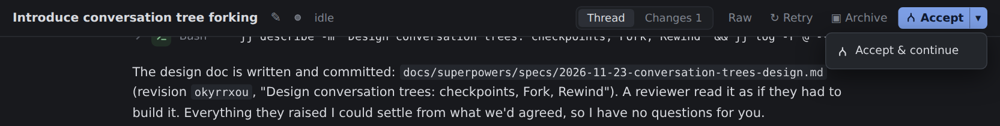
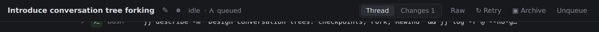
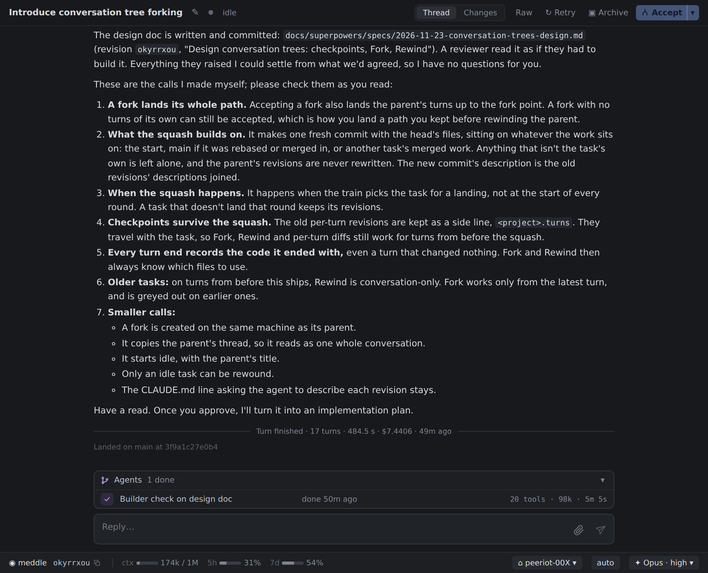

# Accept & continue

## Why

Sometimes you want to land a task's work and keep talking to the same agent, with its context. Today, once the work
lands, the task is archived. Restore gets it back on the default branch with its session resumed
(`reopenReleasedLines`), but only after a round trip: the folder goes, the process stops, and the task sits in the
archive in between.

## Goals

- Accept's split arrow offers **Accept & continue**. It lands the work exactly as Accept does. When the work lands, the
  task stays open, and its workspace is a new change on the default branch's commit. The conversation carries on.
- A plain Accept is unchanged.

## Non-goals

- Tasks with more than one project. Accept already refuses them.
- Telling the agent that its workspace moved. The user can say so in the next prompt.

## Anti-goals

- Any user-facing text beyond the strings listed below.

## What you see

The complete list of added strings:

| Where | Text |
|---|---|
| Task header, right of Accept | `▾` (no tooltip) |
| The ▾'s menu, and the sidebar task menu under Accept | `Accept & continue` (no tooltip) |
| Thread, when the work lands | `Landed on <default branch> at <commit, 12 chars>` (a `status` item) |
| CLI usage | `task accept [--continue] <task-id>...` |

Nothing else changes. The queued badge and its tooltip, the train view, the CLI output, the help text beyond the usage
line, the logs and the user guide all stay as they are.

The `Changes` tab then shows no count, because everything is on the default branch. In the task header, Accept and its
▾ are greyed out whenever the Changes count is 0. That also applies to a fresh task with no work, which today offers
Accept and then fails with "nothing to land".

## Approaches

1. **Store the choice on the queue entry (picked).** A `continue` flag goes next to `queuedAt` on the task's own line
   row. Every way a task leaves the train already clears `queuedAt` (Unqueue, a prompt, the train giving up, archive),
   so clearing the flag with it means the choice can't outlast the Accept it came from.
2. **One-shot flag on the manifest.** It travels with a move, but each of those paths would have to clear it by hand.
   Missing one would silently skip a later archive.
3. **Decide after the fact (Restore → continue).** Less to build, but the task is still archived, which is what this
   feature exists to avoid.

## Design

- **Row:** add an optional `continue: boolean` to `LineRow`, stored in a new `line_rows.continue` column (added through
  the migration list in `src/store/db.ts`, as `queued_at` was). It is written only by `setQueued`, which gains a
  `continue` argument; `setQueued(..., null)` clears it. It travels and merges with `queuedAt`: a peer's copy wins as
  `queuedAt` does, and a copy from an older peer has no flag, which reads as false.
- **Accept:** the contract's `accept` input gains an optional `continue: boolean`. `#accept` passes it to `setQueued`.
  Accepting a task that is already queued still changes nothing, flag included.
- **When the work lands:** where `#acceptOnce` would call `#archive(taskId, true)` and the task's own line has
  `continue` set, it calls a new `#continueOnBranch(taskId)` instead. The gating is the same: idle, nothing queued, no
  turn held. It does the following, under the task's key:
  1. read the default branch's commit (`defaultBranchCommit`);
  2. run `jj new <commit>` in the task's workspace for the project (the old `@` is empty, so jj drops it);
  3. set the manifest's `base` for the project, and the line row's `base`, to `[commit]`, and write the line
     (`#writeLinesNext`);
  4. take the task off the queue (`setQueued(null)`, which notifies queue listeners as the other leave paths do);
  5. record `{ type: "meddle", subtype: "landed", branch, commit }`. `thread-model.ts` renders it as a status item.

  The acceptance check then finds no work above the base, so the verdict is `no`. A failure is logged as an archive
  failure is, and the task is left as it was.
- **A branch pushed by hand** while the task is queued with `continue` goes through the same path, since it all hangs
  off `#acceptOnce`.
- **CLI:** `meddle task accept --continue <id>...` passes the flag for each id.
- **Dashboard:** in `Task.tsx`, the Accept button becomes a split button: Accept, then ▾, which opens a `.popover`
  menu (as `RestoreMenu` does) with the one item. The sidebar's task menu gains the item under Accept. Accept and ▾
  are disabled when `changeCount` is 0 and the count is known.

## Left to the builder

- The split button's CSS (joined radii, a divider) and how the popover is anchored.
- Whether `#continueOnBranch` shares code with `reopenReleasedLines`.
- The column name, if `continue` clashes with anything in SQL.
- Tests: following the existing `#acceptOnce`/archive tests, cover landing with `continue` (task stays idle, `@` on
  the branch, base moved, unqueued, event recorded), `continue` cleared by Unqueue and by a prompt, and a row from an
  older peer with no flag.
